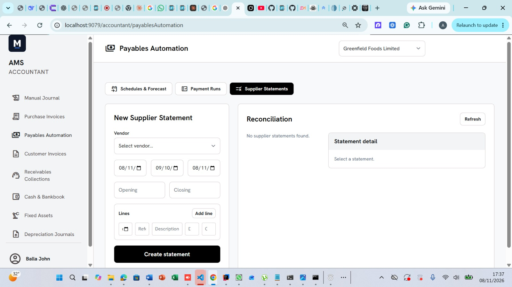

# Payables Automation User Guide

Payables Automation helps you plan supplier payments, process payment batches, and compare supplier statements with your records in AMS.

This guide describes the screen shown below and the current application behavior.

## 1. What each tab does

| Tab | Question it helps you answer |
| --- | --- |
| **Schedules & Forecast** | Which payments are planned, and how much money should we prepare? |
| **Payment Runs** | Which approved payments should we process together? |
| **Supplier Statements** | Do our records agree with what the supplier says we owe? |

The usual payment workflow is:

**Post purchase invoice → Review schedule → Approve schedule → Create payment run → Submit → Approve if required → Execute → Review results**

Supplier statement reconciliation follows a separate workflow:

**Enter statement → Auto-match → Investigate unmatched lines → Match or dispute → Complete**

## 2. Before you begin

Make sure you have:

- Access to the **Accountant** workspace.
- Suppliers registered under the correct organization.
- Purchase invoices entered, approved, and posted.
- An active bank account for payment runs.
- An open accounting period for the payment date.

Open **Payables Automation** from the left menu. Check the organization selector at the top right before working. The screenshot shows **Greenfield Foods Limited**.

The selected organization determines which suppliers, schedules, bank accounts, payment runs, and statements you work with.

## 3. Review payment schedules

Open **Schedules & Forecast**.

A payment schedule records when you intend to pay an invoice and how much remains to be paid.

When an invoice with an outstanding balance is posted, AMS creates a default schedule. The scheduled payment date initially matches the invoice due date, and the default priority is **5**.

### Understand the schedule table

| Column | Meaning |
| --- | --- |
| Checkbox | Select an approved schedule for a payment run |
| Vendor | Supplier receiving payment |
| PO / Invoice | Purchase order reference, or invoice identifier |
| Due | Original invoice due date |
| Scheduled | Date you plan to pay |
| Remaining | Unpaid amount on this schedule |
| Priority | Assigned priority number |
| Status | Current processing stage |
| Actions | Actions available for the schedule |

**Due and Scheduled can differ.** An invoice may be due on 12 November, while you plan to pay it on 16 November. The forecast uses the scheduled payment date.

### Find schedules

1. Enter the beginning of the period in the first date field.
2. Enter the end in the second date field.
3. Leave **All statuses** selected to review active schedules in that period.
4. Click **Refresh**.

The initial period runs approximately from 30 days before today to 30 days after today.

To view a particular status, select it and click **Refresh**. To see planned or approved schedules scheduled for today or earlier, click **Due only**. Click it again to return to the normal view.

> **Filter behavior:** A specific status takes precedence over the date range. **Due only** overrides both date and status filters. The normal dated **All statuses** view shows active schedules; choose **PAID** or **CANCELLED** explicitly to see those records.

### Approve a schedule

1. Check the supplier, invoice, amount, and scheduled date.
2. Click **Approve**.
3. Check the resulting status.

Depending on your organization's approval rules, the schedule becomes:

- **APPROVED**: ready to select for a payment run.
- **READY_FOR_APPROVAL**: submitted and awaiting approval.

The first **Approve** click can therefore start approval rather than finish it. Follow your organization's approval procedure. Only **APPROVED** schedules have enabled selection checkboxes.

### Hold a schedule

Use **Hold** when a payment should wait, for example while a supplier query is investigated.

1. Click **Hold**.
2. Enter a clear reason.
3. Submit the dialog.
4. Confirm the status is **HELD**.

Held schedules are excluded from the cash forecast and payment-run selection.

### Reschedule a payment

1. Click **Reschedule**.
2. Enter the revised payment date.
3. Review the amount and priority.
4. Enter the reason and submit the dialog.
5. Check the updated schedule.

Use a positive amount within the invoice's actual outstanding balance. The priority field accepts **1–9**; follow your organization's convention because the screen does not explain which end represents greater urgency.

Rescheduling a **HELD** schedule returns it to **PLANNED** and clears the hold. Approve it again before including it in a payment run.

### Cancel a schedule

Click **Cancel**, enter the reason, and submit the dialog. Confirm the status is **CANCELLED**.

Cancelling a schedule does not cancel the purchase invoice or remove the amount owed to the supplier. Paid schedules cannot be cancelled.

## 4. Forecast cash requirements

The **Cash Requirement** panel answers:

**“How much money should we prepare for scheduled supplier payments?”**

It uses the remaining amounts and scheduled payment dates of **PLANNED** and **APPROVED** schedules. Planned payments are included even though they are not yet approved for payment.

Held schedules, schedules awaiting approval, and paid or cancelled schedules are excluded.

### Load a forecast

1. Enter the forecast start date in the first date box.
2. Enter the forecast end date in the second date box.
3. Choose **Daily** or **Weekly**.
4. Click **Load forecast**.

Use **today as the start date** for the clearest day-to-day view. The default period starts today and extends 28 days forward.

| Choice | What it displays |
| --- | --- |
| **Daily** | Scheduled amount for each day |
| **Weekly** | Scheduled amount for each seven-day block starting from your chosen start date |

Changing the grouping does not move payment dates or create payments.

### Example: understand the totals

Assume today is **10 November 2026**, and these schedules exist:

| Supplier | Scheduled date | Remaining amount | Status |
| --- | --- | ---: | --- |
| Alpha Supplies | 9 November | 50,000 | APPROVED |
| Beta Trading | 12 November | 100,000 | APPROVED |
| City Packaging | 16 November | 80,000 | PLANNED |
| Delta Services | 18 November | 40,000 | HELD |

Load a forecast for **10–23 November 2026**.

| Figure | Amount | Explanation |
| --- | ---: | --- |
| **Scheduled** | 180,000 | Beta's 100,000 plus City's 80,000 fall within the selected period |
| **Overdue** | 50,000 | Alpha's scheduled date is before the forecast start date |
| **Due soon** | 180,000 | Both included payments are scheduled on or before 17 November, seven days from today |

Delta's 40,000 is excluded because it is held.

**Do not add all three totals together.** Due soon is already part of Scheduled.

If you plan to clear the earlier unpaid schedule and pay everything scheduled in this period, prepare:

**50,000 overdue + 180,000 scheduled = 230,000**

Weekly grouping would show:

| Period | Scheduled amount |
| --- | ---: |
| 10–16 November | 180,000 |
| 17–23 November | 0 |

### Understand the date rules

- **Scheduled** includes eligible schedules within the selected start and end dates.
- **Overdue** means scheduled before the selected forecast start date. It does not use the original invoice due date. Choosing a future start date can therefore include payments that are not yet overdue today.
- **Due soon** includes eligible schedules within the selected period whose scheduled date is on or before seven days from today. The seven-day limit stays tied to today when you change the forecast dates.

### Use the forecast to make decisions

1. Load a forecast starting today.
2. Review earlier unpaid amounts and upcoming requirements.
3. Compare them with available bank funds.
4. Decide which schedules to approve, hold, or reschedule.
5. Reload the forecast after making changes.

The forecast shows planned cash requirements. It does not display available bank funds, reserve money, or make payments.

## 5. Create a payment run

A payment run groups approved schedules for processing from one bank account.

### Choose the schedules

Use one of these methods:

| Method | What to do | What AMS includes |
| --- | --- | --- |
| Manual selection | Tick approved schedules in **Schedules & Forecast** | The selected eligible schedules |
| Cutoff selection | Leave all schedules unticked | Eligible approved schedules scheduled on or before the cutoff date |

For manual selection, the cutoff date does not restrict the schedules you explicitly select.

Eligible schedules must belong to the selected organization, be **APPROVED**, have a positive remaining amount, and have no pending item in another payment run.

### Enter the run details

1. Select schedules if using the manual method.
2. Open **Payment Runs**.
3. Check the selection message below the date fields.
4. Select the **Bank account**.
5. Enter the **Run date** and **Cutoff date**.
6. Click **Create payment run**.
7. Review the new run's suppliers, amounts, and dates.

| Field | Meaning |
| --- | --- |
| Bank account | Account used for the recorded payments |
| Run date | Date used to post the payments when the run is executed |
| Cutoff date | Latest scheduled date included by automatic selection |

**Example:** With no schedules ticked and a cutoff of 16 November, AMS selects eligible approved schedules scheduled on or before 16 November. A planned schedule is excluded until approved.

> Refreshing or reloading the schedules table clears its checkboxes. Check the selection message before creating a run. If nothing is selected, AMS uses the cutoff method and may include more schedules than you intended.

## 6. Submit, approve, and execute a payment run

Select a run from the list to open **Run detail**. Check its total, dates, suppliers, purchase order references, and individual amounts.

### Submit

1. Open a **DRAFT** run.
2. Click **Submit**.
3. Check the new status.

It becomes **READY_FOR_APPROVAL** if approval is required, or **APPROVED** if the configured rules allow automatic approval.

### Approve

An authorized approver reviews the run, clicks **Approve**, and checks that it becomes **APPROVED**. Follow your organization's approval procedure.

### Execute

1. Open the approved run.
2. Confirm the bank account, payment date, suppliers, and amounts.
3. Click **Execute**.
4. Inspect the resulting run status and every item.

Execution records supplier payments in AMS, posts accounting entries, updates invoice balances, and marks successfully processed schedules as paid.

> The implementation covered by this guide records payments within AMS. It does not show a transfer instruction being sent to a bank. Follow your organization's banking procedure and confirm actual settlement separately.

### Understand the result

| Run status | Meaning |
| --- | --- |
| **DRAFT** | Created; not yet submitted |
| **READY_FOR_APPROVAL** | Awaiting approval |
| **APPROVED** | Ready to execute |
| **EXECUTED** | All items processed successfully |
| **PARTIALLY_EXECUTED** | Some items succeeded and others failed |
| **CANCELLED** | Run was cancelled, or all items failed during execution |

Individual items show **PENDING**, **PAID**, **FAILED**, or **CANCELLED**. Failed items display a failure reason.

Always review the items, even if a success message appears after execution.

### Handle failed items

1. Read each failure reason.
2. Check the invoice balance, schedule, accounting period, and account setup.
3. Correct the underlying issue.
4. Create a new run containing only eligible unpaid schedules.

Successful items remain recorded when other items fail. A partially executed run has no Execute button for retrying the entire batch.

### Cancel a run

Open an eligible unexecuted run and click **Cancel**. This cancels its items, not the underlying invoices.

Executed and partially executed runs cannot be cancelled through this screen.

## 7. Enter a supplier statement

A supplier statement is a summary sent by a supplier showing the opening amount owed, transactions during a period, and the closing amount owed.

The **Supplier Statements** tab helps you answer:

**“Does our record agree with what the supplier says we owe?”**

Entering a statement does not create purchase invoices or record payments. Those records must already exist in AMS, or be entered through the relevant functions before matching.

### Understand the screen

The screenshot shows:

- **New Supplier Statement** on the left: enter the statement here.
- **Reconciliation** on the right: select and review saved statements here.
- **Refresh**: reload the saved statement list.
- **No supplier statements found**: no statements are listed for the selected organization.
- **Select a statement**: the detail panel is waiting for you to choose a saved statement.

### Example statement

Suppose Alpha Supplies sends an October statement on **3 November 2026**:

| Item | Amount |
| --- | ---: |
| Amount owed at the beginning of October | 20,000 |
| Goods invoiced during October | 100,000 |
| Payment received during October | 40,000 |
| Amount owed at the end of October | 80,000 |

The calculation is:

**20,000 opening + 100,000 charges − 40,000 payment = 80,000 closing**

### Step 1: Enter the header

| Field | Example | What it means |
| --- | --- | --- |
| Vendor | Alpha Supplies | Supplier that issued the statement |
| First date box | 3 November 2026 | Date printed on the statement |
| Second date box | 1 October 2026 | Beginning of the statement period |
| Third date box | 31 October 2026 | End of the statement period |
| Opening | 20,000 | Balance at the beginning of the period |
| Closing | 80,000 | Balance at the end of the period |

The three date fields are arranged left to right:

**Statement date → Period start date → Period end date**

The statement date can be later than the period end date. Hover over a date field to see its title, or use the calendar picker if the displayed date format is unclear.

Enter actual balances. Blank opening and closing fields are saved as zero.

### Step 2: Enter transaction lines

A **line** is one transaction on the supplier's statement. One blank row is provided. Click **Add line** for each additional transaction.

Each row contains these fields from left to right:

**Date → Reference → Description → Debit → Credit**

For the example, enter:

| Date | Reference | Description | Debit | Credit |
| --- | --- | --- | ---: | ---: |
| 8 October 2026 | PO-1042 | Goods supplied | 100,000 | 0 |
| 20 October 2026 | PAY-006 | Payment received | 0 | 40,000 |

The opening 20,000 belongs in **Opening**. Do not also enter it as a new transaction, which would count it twice when checking the statement arithmetic.

Every included line needs a **date and reference**. Description is optional.

### Understand Debit and Credit

For this application's matching process:

| Transaction | Amount field |
| --- | --- |
| Invoice or charge being checked against a purchase invoice | **Debit** |
| Payment being checked against a recorded supplier payment | **Credit** |

Enter a positive amount in the appropriate field and leave the other at zero.

Suppliers may use different debit and credit conventions on their printed statements. Identify whether each transaction increases or reduces the amount owed before entering it. Credit notes and other adjustments may require investigation because automatic matching has limited support for them.

### Understand the reference limitation

For invoice matching, AMS compares the statement reference with the **purchase order number stored on the purchase invoice**.

For example, a supplier reference of `INV-882` will not automatically match an AMS purchase order reference of `PO-1042`, even if both relate to the same invoice.

Keep the supplier's actual reference when recording its statement. Investigate reference differences against your purchase records rather than assuming an unmatched line is incorrect.

### Step 3: Save the statement

1. Confirm the organization and vendor.
2. Check the statement date and period dates.
3. Check opening and closing balances.
4. Review each transaction's date, reference, and amount.
5. Click **Create statement**.
6. Select the saved statement in **Reconciliation** to review it.

A row with neither a date nor a reference is omitted, even if you entered a description or amount. A row with only one of the two required fields will fail validation.

The current screen has no visible controls to remove an added row or edit a saved statement. Check your entries carefully before saving.

## 8. Reconcile the supplier statement

### Step 1: Run Auto-match

Select the saved statement and click **Auto-match**. AMS tries to link unmatched lines with existing records.

| Line type | Matching rules |
| --- | --- |
| Invoice | Same organization and supplier; reference equals the invoice's purchase order number; debit equals the full invoice total |
| Payment | Same date and credit amount as a supplier-payment ledger entry in the organization |

For the example, `PO-1042` can match the same supplier's invoice with a full total of 100,000. The 40,000 credit can match a supplier payment recorded on 20 October.

**Review payment matches carefully.** The current payment matching does not additionally verify supplier identity or payment reference. Two suppliers paid the same amount on the same date could lead to an incorrect match.

### Step 2: Review line statuses

| Status | Meaning | What to do |
| --- | --- | --- |
| **MATCHED** | A corresponding record was found | Confirm it is the correct record |
| **UNMATCHED** | No match was found under the rules | Investigate dates, references, amounts, and missing records |
| **DISPUTED** | The line has been flagged for investigation | Document and follow up on the issue |

An unmatched line can still be valid. A supplier payment dated 21 October will not match an AMS payment dated 20 October under the current rules.

Correct relevant source records where appropriate and run **Auto-match** again. It processes lines still marked UNMATCHED. This screen has no manual match selector.

### Step 3: Dispute genuine issues

Use **Dispute** for issues such as duplicate invoices, incorrect charges, goods not received, or payments needing clarification.

1. Click **Dispute** on the relevant line.
2. Enter a clear reason, such as: “Supplier charged 25,000; approved invoice is 20,000. Clarification requested.”
3. Submit the reason.
4. Confirm the line is **DISPUTED**.

Disputing a matched line removes its match. The screen has no visible action to return a disputed line to unmatched. Check carefully before using it.

Do not dispute a valid line merely to make Complete available.

### Step 4: Check Open lines and balances

**Open lines counts only UNMATCHED lines.**

| Example | Open lines |
| --- | ---: |
| One matched line and one unmatched line | 1 |
| One matched line and one disputed line | 0 |

Check the statement arithmetic yourself. For the example:

**20,000 + 100,000 − 40,000 = 80,000**

Also check that the opening balance agrees with the previous period and that all expected transactions are included. Matching individual lines alone does not prove the overall balance is correct.

### Step 5: Complete

1. Confirm all matches are correct.
2. Review and document any disputes.
3. Confirm **Open lines = 0**.
4. Verify the opening balance, transactions, and closing balance.
5. Click **Complete**.
6. Check that the statement is **COMPLETED**.

AMS permits completion when every line is matched or disputed. It does not automatically verify the opening-to-closing balance calculation.

**COMPLETED means the lines have been processed in this screen. It can still include unresolved disputes requiring follow-up.**

## 9. Troubleshooting

| Problem | What to check |
| --- | --- |
| No schedules appear | Confirm the organization, widen the date range, turn off Due only, and confirm invoices were posted |
| Paid or cancelled schedules are missing | Select the specific status and click Refresh |
| Schedule checkbox is disabled | The schedule must be APPROVED |
| No schedules are eligible for a run | Check approval, remaining amounts, cutoff date, and pending items in existing runs |
| Bank account is rejected | Choose an active account belonging to the selected organization |
| Execute is unavailable | The run must be APPROVED |
| An item fails during execution | Read its failure reason; check invoice balance, open accounting period, approval, and posting accounts |
| Forecast is lower than expected | Check scheduled dates and excluded statuses, especially HELD and READY_FOR_APPROVAL |
| Forecast Overdue looks unexpected | It uses the forecast start date, not the invoice due date; try starting today |
| Statement line fails validation | Enter both date and reference |
| Invoice line stays unmatched | Check supplier, purchase order reference, and full invoice total |
| Payment line stays unmatched | Check the recorded payment date and credit amount |
| Complete is unavailable | At least one line remains UNMATCHED |
| Fields or table columns are cut off | Maximize the browser, reduce zoom slightly, or scroll the detail table horizontally |

## 10. Routine checklist

### Before payments

- Confirm the organization.
- Review due schedules, holds, and approval statuses.
- Load a forecast starting today and compare it with available funds.
- Check the intended schedules, bank account, amounts, and run date.

### After payments

- Review every payment-run item, including failure reasons.
- Check existing results before creating a replacement run.
- Confirm actual bank settlement separately.

### When reconciling statements

- Enter the supplier's dates, references, balances, and transactions accurately.
- Review automatic matches.
- Investigate unmatched lines and document genuine disputes.
- Check the balance calculation before completing.
- Follow up on disputes, including those on completed statements.
